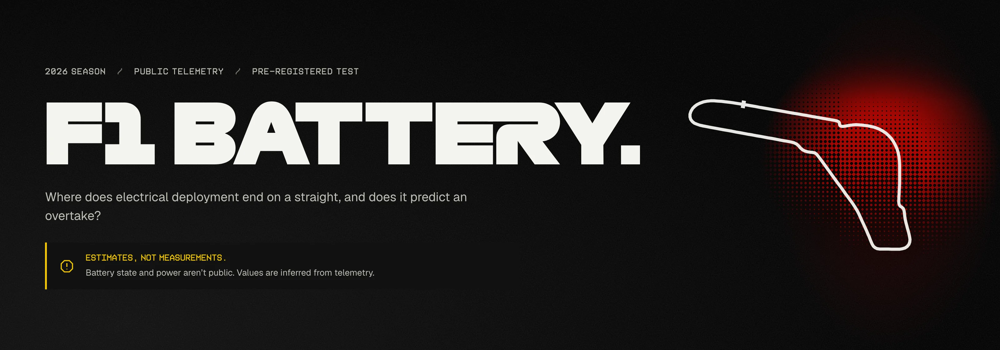
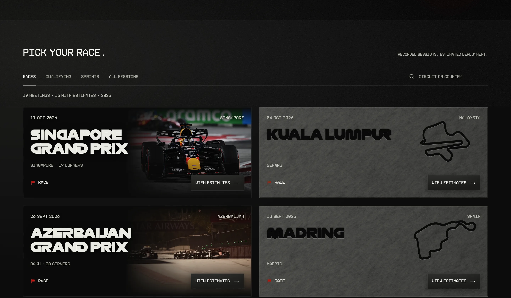
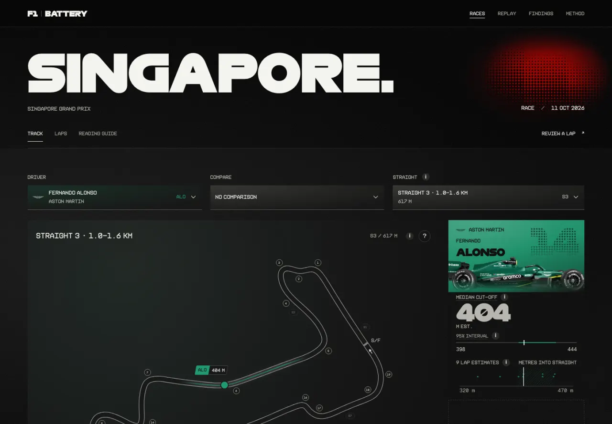
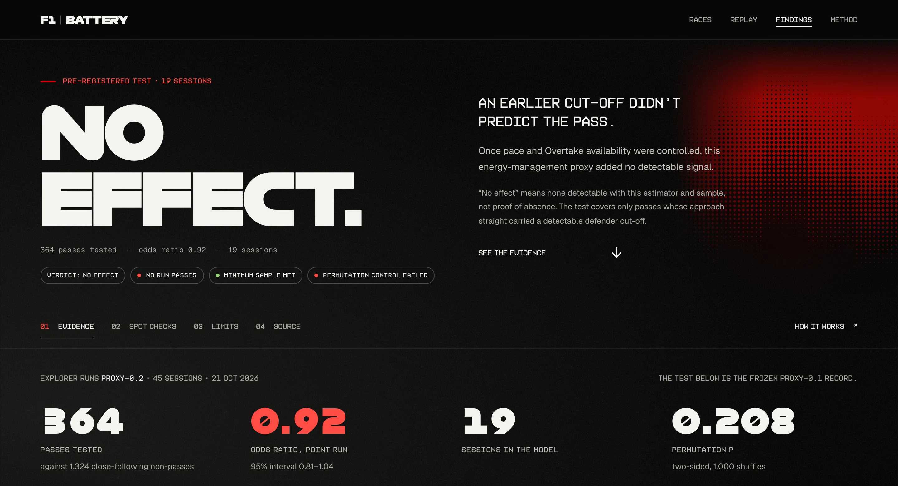
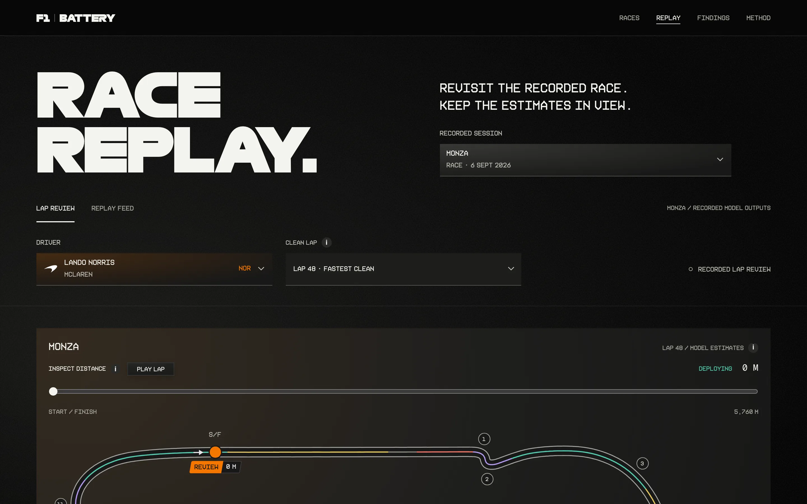
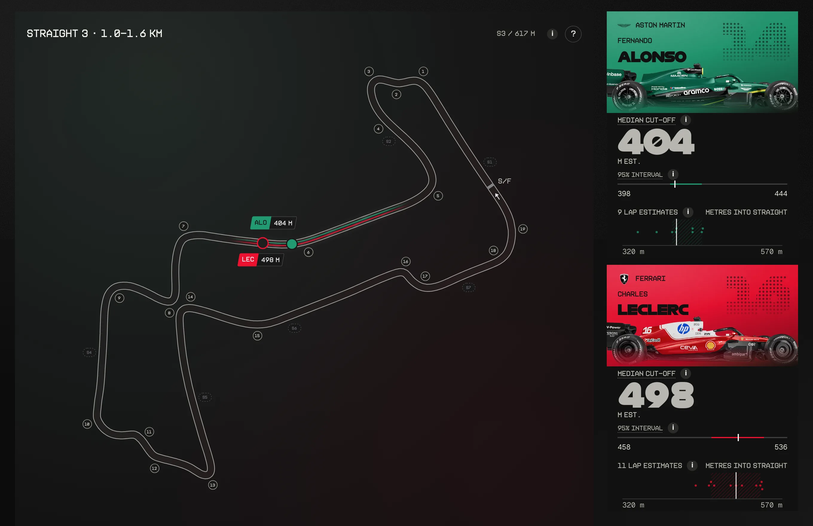
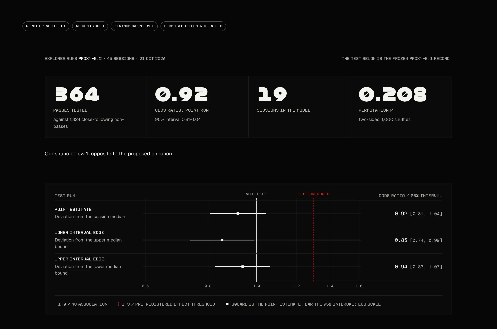
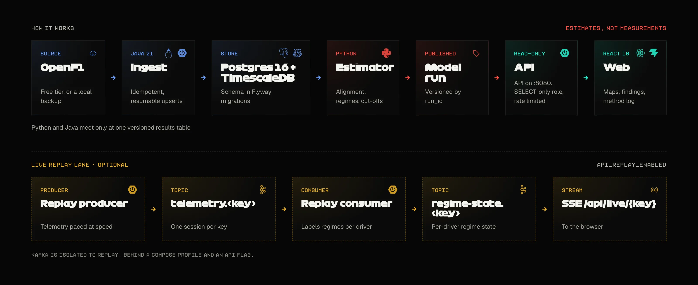
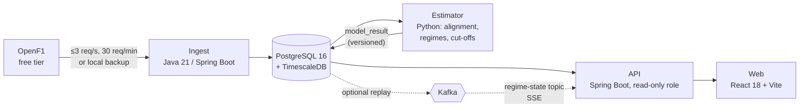
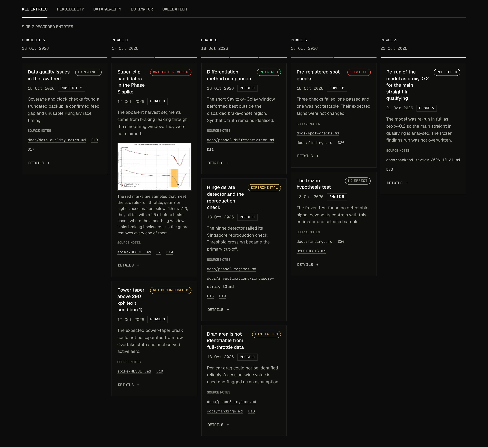

Estimates where electrical deployment ends on each straight from public telemetry, then tests one pre-registered question against real overtakes.

Status: Phases 0 to 6 are built and the findings are written (2026-10-18). The optional Phase 7 live replay (Kafka) is built. **Not deployed yet** (Phase 1.5).

**Estimates, not measurements.** F1 does not publish battery or active-aero data for 2026, so this project never measures battery state and never reports a state of charge. It estimates where electrical deployment ends on each straight from public speed, throttle and position telemetry, under stated assumptions, and says so everywhere it shows a number.

## Why this exists

The 2026 cars split power between the combustion engine and an electric motor, and energy management (deployment, harvesting, derating) shapes how a straight plays out. F1 chose not to publish ERS or active-aero data ([FastF1 maintainer, 2026-03-14](https://github.com/theOehrly/Fast-F1/discussions/861)). The FIA rules do state how much electric power a car may use at each speed (Section C, Article C5.2.8), so the hidden state is partly constrained by known rules. That makes an estimate worth attempting, and it makes an honest test of the estimate possible.

Several small per-race estimators already exist (DECISIONS.md D1). This project adds a season-wide engineered pipeline and a pre-registered test against an observable outcome, overtakes.

## What it does

- **Ingests the 2026 season** from OpenF1 into PostgreSQL + TimescaleDB with an idempotent, resumable Java job.
- **Aligns telemetry to laps and distance**, with a per-session data-quality report and curated straight definitions.
- **Estimates energy-management proxies per straight and lap**: the distance where deployment appears to end (the "cut-off"), relative deploy energy, and regime labels (deploy, plateau, lift, brake), each with bootstrap intervals.
- **Tests one pre-registered question** against 830 extracted passes and 3,889 close-following non-passes, with the hypothesis frozen before any estimator output existed.
- **Serves an explorer**: a read-only Spring Boot API and a React app with track maps, per-driver cut-offs, lap review, the findings, and a method log of every estimator that failed a check.
- **Replays a session live (optional)**: telemetry paced through Kafka, labelled per driver, streamed to the browser.

### The explorer



**Races.** Pick a 2026 session.



**Session.** One driver on one straight: the estimated cut-off and its interval.



**Findings.** The frozen result, spot checks and limits.



**Replay.** Review a recorded lap, or follow the optional live feed.

### What one estimate is

Each estimate is the distance into a straight where deployment appears to end, with an interval across laps. Below, the app's Singapore race page (session 11388) on straight 3: the median cut-off for two drivers, each with its 95% interval across laps. These are estimates under stated assumptions, not measurements.



## The result



The question, frozen on 2026-10-18 (see [HYPOTHESIS.md](HYPOTHESIS.md)): *does a defender's energy management before an attack predict being passed?* The recorded outcome, produced by `model/f1battery_model/hypothesis_test.py` from model run `proxy-0.1`:

| | |
|---|---|
| Passes tested | 364, against 1,324 non-passes |
| Sessions in the model | 19 |
| Odds ratio per 1 SD earlier defender cut-off (point run) | 0.92 [0.81–1.04] |
| Permutation p (two-sided, 1,000 shuffles) | 0.208 |
| Verdict | **no detectable effect** |

An earlier cut-off on the approach straight did not predict being passed. Pace difference and Overtake availability did. "No effect" means none detectable with this estimator and sample, not proof of absence, and the test covers only passes whose approach straight carried a detectable defender cut-off. The permutation control failed, and three of the four testable spot checks failed too; both are reported rather than tuned away. Full write-up: [docs/findings.md](docs/findings.md).

## How it works



The same flow as text:



- **One interface between Java and Python.** The model writes a single versioned results table; the API reads it. All schema lives in Flyway migrations ([DECISIONS.md D4](DECISIONS.md)).
- **Ingestion is rerunnable.** Upserts on natural keys and an ingestion log mean a second full run inserts 0 rows ([docs/phase1-ingestion.md](docs/phase1-ingestion.md)).
- **The API is read-only.** It connects as the `f1_api` role (SELECT only), is rate limited, and publishes derived aggregates, never raw samples.
- **Kafka is optional and isolated** to the replay mode, behind a Compose profile and an API flag ([docs/phase7-replay.md](docs/phase7-replay.md)).
- **Planned hosting:** an Oracle Cloud ARM free-tier instance for the database and jobs, plus a small AWS piece (private S3 backup of cached raw data). None of it is deployed yet.

| Phase | What | Note |
|---|---|---|
| S | Feasibility spike | Result 1/3, so proxy mode ([spike/RESULT.md](spike/RESULT.md)) |
| 0–1 | Setup, ingestion | [phase1-ingestion.md](docs/phase1-ingestion.md) |
| 2 | Alignment, data quality, straights | [phase2-alignment.md](docs/phase2-alignment.md) |
| 3 | Differentiation, regimes | [phase3-differentiation.md](docs/phase3-differentiation.md), [phase3-regimes.md](docs/phase3-regimes.md) |
| 4 | Estimator (proxy mode) | [phase4-estimator.md](docs/phase4-estimator.md) |
| 5 | Event and non-event sets | [phase5-events.md](docs/phase5-events.md) |
| 6 | API and view | [phase6-api-view.md](docs/phase6-api-view.md) |
| 7 | Live replay with Kafka (optional) | [phase7-replay.md](docs/phase7-replay.md) |

## Run it locally

Requirements: Docker, Java 21, Node, and Python 3.12 or newer for the model. Raw OpenF1 data is never committed, so a fresh clone starts with an empty database; the ingest step needs the local backup at `data/raw/openf1/` or the live API source.

```bash
# 1. Database (TimescaleDB on 127.0.0.1:55432)
docker compose up -d db

# 2. Ingest the 2026 season (idempotent; run it again after a new race)
mvn -B -q install -DskipTests -pl db
INGEST_LOCAL_ROOT=$PWD/data/raw/openf1 \
mvn -pl ingest spring-boot:run -Dspring-boot.run.arguments="--source=local --year=2026"

# 3. Model: align laps, then write the estimates
cd model
../.venv/bin/python -m f1battery_model.quality --all
../.venv/bin/python -m f1battery_model.straights
../.venv/bin/python -m f1battery_model.regulation
PYTHONPATH=. ../.venv/bin/python -m f1battery_model.estimate --all
cd ..

# 4. API on :8080
JAVA_HOME=$(/usr/libexec/java_home -v 21) mvn -B -q -pl api -am package -DskipTests
DB_URL=jdbc:postgresql://localhost:55432/f1battery java -jar api/target/api-*.jar

# 5. Web on :5173 (VITE_API_BASE overrides http://localhost:8080)
cd web && npm ci && npm run dev
```

Use `--source=api` instead of `--source=local` to fetch from OpenF1 within its free-tier limits. Create the model's virtual environment at `.venv` from `model/pyproject.toml`.

Checks:

```bash
mvn -B -q -pl api -am verify         # API integration tests (Testcontainers, needs Docker)
cd web && npm run build              # type-check, lint, bundle
cd model && ../.venv/bin/python -m pytest tests
```

Optional live replay (Kafka on `127.0.0.1:9092`):

```bash
docker compose --profile replay up -d
mvn -B -q -pl replay -am package -DskipTests
java -jar replay/target/replay-0.1.0-SNAPSHOT.jar --mode=producer --session=11361 --speed=20 --drivers=1,63
java -jar replay/target/replay-0.1.0-SNAPSHOT.jar --mode=consumer --session=11361
API_REPLAY_ENABLED=true java -jar api/target/api-0.1.0-SNAPSHOT.jar
```

See [docs/phase7-replay.md](docs/phase7-replay.md) for ports, cleanup and limits.

## Data and limits

- **Source:** [OpenF1](https://openf1.org/) free historical tier (non-commercial use), plus [FastF1](https://docs.fastf1.dev/) where useful. The 2026 season is loaded through Singapore: 50 sessions, 48 with data and 2 with none.
- **Excluded:** Hungary race 11342 (lap and pit timestamps disagree with telemetry by 3–6 minutes, D17). Sakhir and Jeddah have no usable data.
- **No ground truth.** No public battery data exists. The spot checks are the only external anchors, and three of the four testable ones failed.
- **Drag area is not identifiable.** A session-wide value is used and sits at a grid bound in 16 of 45 sessions; relative deploy energy inherits this.
- **Coarse telemetry.** 3.7 Hz with integer speeds, so cut-off distances carry tens of metres of lap-to-lap scatter.
- **Selection.** Only passes whose approach straight has a detected defender cut-off on the previous lap enter the test.
- **Unknown limits.** Per-event race energy limits are not public; the 100 kW/s derate rate is an assumption.
- **A caught artifact.** The spike's first "super-clip" segments were a smoothing artifact, and a hinge-ramp detector failed its Singapore check. Both are recorded in [docs/method-log.md](docs/method-log.md); the primary variable is the threshold-crossing cut-off.

## Project record



Phase notes are linked in the table under How it works; the files below are the record.

| File | Purpose |
|---|---|
| [PLAN.md](PLAN.md) | Phases and exit conditions |
| [HYPOTHESIS.md](HYPOTHESIS.md) | Pre-registered test, frozen before Phase 4 output existed |
| [DECISIONS.md](DECISIONS.md) | Decision log: what was chosen and why |
| [docs/findings.md](docs/findings.md) | The test result, with every number reproducible from a committed script |
| [docs/method-log.md](docs/method-log.md) | Each estimator attempt and what its check showed |
| [docs/spot-checks.md](docs/spot-checks.md) | Pre-registered external checks |
| [docs/regulations.md](docs/regulations.md) | FIA energy limits per event, cited |
| [docs/data-quality-notes.md](docs/data-quality-notes.md) | Known problems in the raw feed |
| [docs/api-contract.md](docs/api-contract.md) | API endpoints |
| [AGENTS.md](AGENTS.md) | Working rules for AI agents in this repo |
| [spike/](spike/) | Feasibility spike scripts and result |

## Credits and terms

Private, non-commercial project. Data from [OpenF1](https://openf1.org/) under its non-commercial terms; raw and per-sample data are never committed or redistributed, and the public API serves derived aggregates only. Not affiliated with Formula 1, the FIA or FOM. Team and driver imagery, logos and the typefaces used in the web app belong to their owners, are used privately and for non-commercial study, and are credited in the app footer; texture, mask and typeface sources are listed in [web/public/assets/ASSETS.md](web/public/assets/ASSETS.md). The images in this README are rendered from the web app and contain such material. No licence is granted for it.
