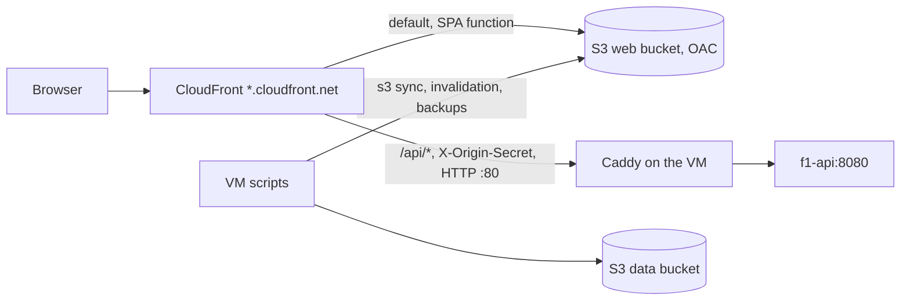

# f1-battery AWS front door

Terraform root (own state) for the public site. It mirrors RCP's `infra/aws-demo` dashboard
(private S3 + Origin Access Control + CloudFront + a viewer-request function + response-headers
policy) and adds the Oracle VM as a second origin for `/api/*`. No domain, DNS zone, or certificate:
the site lives at the default `https://<id>.cloudfront.net`.



## What it creates

- `web` bucket: private, OAC-only read; holds `web/dist` (`aws s3 sync --delete` from the VM).
- `data` bucket: private, versioned; `private-assets/`, `db-backups/`, `raw/`. Lifecycle: `db-backups/`
  expire after 14 days, noncurrent `raw/` versions after 7.
- CloudFront (price class 100, IPv6, TLS 1.2_2021, default certificate, HTTP/2 and 3):
  - default behaviour: `web` origin; `spa.js` maps `/`, `/session`, `/findings`, `/method`, `/replay`
    to their `.html` page, everything else passes through; HSTS, nosniff, referrer, frame-deny headers.
  - `/api/*`: the VM over HTTP port 80 (`http-only`), managed CachingDisabled cache policy,
    AllViewerExceptHostHeader origin request policy, GET/HEAD/OPTIONS only, and the custom origin
    header `X-Origin-Secret`.
  - `/api/live/*`: same VM through a second origin with a 60 s read timeout, no compression.
- IAM user `f1-battery-vm`, inline policy: Put/Get/List on `private-assets/`, `db-backups/`, `raw/` of the
  data bucket only; PutObject/DeleteObject/ListBucket on the web bucket; `cloudfront:CreateInvalidation` on
  this distribution. No other permission.

## Apply

```sh
cd infra/aws-f1
cp terraform.tfvars.example terraform.tfvars        # set origin_secret: openssl rand -hex 24
export AWS_PROFILE=<your-profile>                   # an admin-capable profile on your Mac, not the VM user
terraform init
terraform plan -out plan.tfplan
terraform apply plan.tfplan
```

CloudFront takes 5 to 15 minutes to deploy. Local validation only proves syntax and references
(`terraform fmt -check`, `terraform validate`), not that AWS accepts the plan.

## Copy the outputs to the VM

`terraform output` (nonsecret) into `deploy/oracle/.env`:

| Output | `.env` key |
| --- | --- |
| `site_url` | `F1_SITE_URL` |
| `web_bucket` | `F1_WEB_BUCKET` |
| `data_bucket` | `F1_S3_BUCKET` |
| `distribution_id` | `F1_CF_DISTRIBUTION` |

`F1_ORIGIN_SECRET` is the `origin_secret` you set in `terraform.tfvars`; `F1_ORIGIN_HOST` is `origin_host`.

The VM's credentials file `deploy/oracle/secrets/aws_credentials` (mode 0600) is written by hand:

```ini
[default]
aws_access_key_id = <terraform output vm_access_key_id>
aws_secret_access_key = <terraform output -raw vm_secret_access_key>
```

The secret is the one sensitive output and lives in Terraform state, as does `origin_secret` (it is
a CloudFront origin header). Keep the state local or in a private encrypted backend; never commit it
(`.gitignore` excludes it). To rotate the key: `terraform apply -replace=aws_iam_access_key.vm`, then rewrite the file.

## Origin host: IP address caveat

`origin_host` defaults to the VM's IPv4, `84.8.217.209`. CloudFront documents custom origins as DNS
names and may reject a bare IP at apply time. If `apply` fails on the origin, set
`origin_host = "84.8.217.209.sslip.io"` (a public wildcard name that resolves to the IP; no registration)
and the same value as `F1_ORIGIN_HOST` in the VM's `.env`. With AllViewerExceptHostHeader, CloudFront sends the
origin's host name as `Host`, which is what Caddy's site block matches. Not exercised: no AWS calls were made.

## Live feed through CloudFront

`/api/live/*` is Server-Sent Events. CloudFront buffers streamed origin responses poorly, so events can
arrive in chunks instead of one by one, and a connection is cut when the 60 s origin read timeout passes
with no bytes (the API sends keep-alive comments; check its interval is under 60 s). This is accepted. A
polling fallback is out of scope. The `/api/live/*` behaviour exists so that path never caches or compresses.

## Cost

Everything here sits inside the always-free tier for a low-traffic demo: CloudFront 1 TB out and 10 M
requests per month, S3 a few MB of site plus the backups (14 days of dumps), one IAM user. Free-tier
limits change and S3 storage past its 12-month allowance costs cents per GB per month. Budget alerts
are not created here; RCP's account-wide budget already covers the account.

## Precedent

RCP's `infra/aws-demo` (`dashboard.tf`, `spa.js`, README "Contract"): same OAC pattern, a zero minimum cache TTL
so `index.html` can be replaced uncached, `bucket_prefix` bucket names, no access key secret on the
Terraform side other than as a sensitive output. Differences: no Cognito, no Lambda or SQS, and the API origin
is the VM itself behind a shared-secret header.
